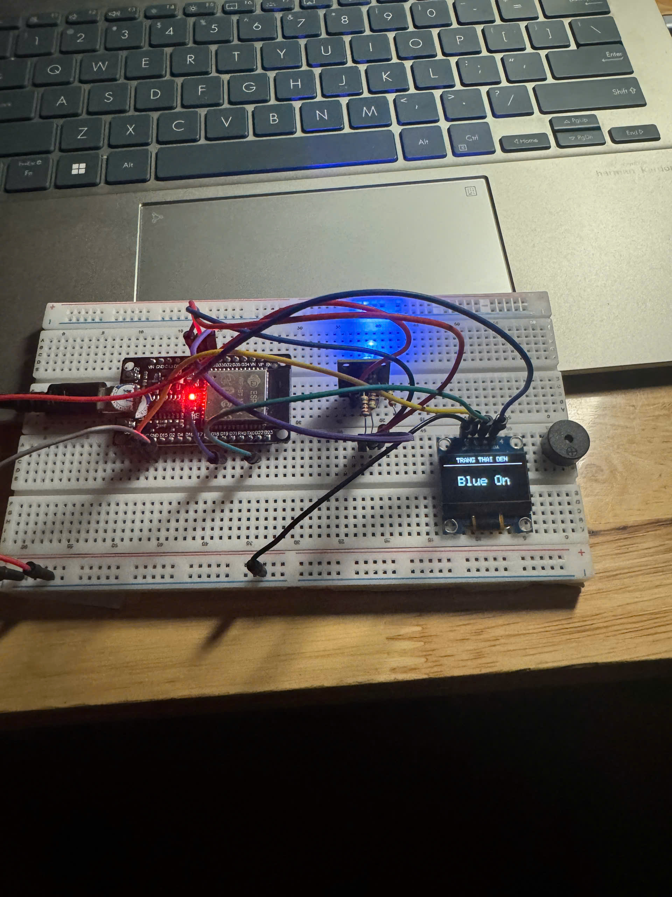

# Điều khiển đèn LED RGB qua Blynk IoT & Hiển thị OLED SSD1306 với ESP32

Dự án điều khiển đèn LED RGB từ xa qua Internet (WiFi / 4G) bằng ứng dụng Blynk IoT trên điện thoại, đồng thời hiển thị trạng thái các màu đèn theo thời gian thực (tự động căn giữa) trên màn hình OLED SSD1306.

## Tính năng chính
* Bật/tắt nguồn tổng và điều khiển độc lập 3 màu đèn **Red**, **Green**, **Blue** từ xa qua ứng dụng **Blynk IoT**.
* Tự động đồng bộ lại trạng thái công tắc từ Blynk Cloud mỗi khi ESP32 khởi động lại (`Blynk.syncAll()`).
* Hiển thị trạng thái đèn trực quan, căn giữa tự động trên màn hình OLED bằng hàm `getTextBounds()`:
  * Tắt nguồn tổng: `ALL OFF`
  * Bật nguồn nhưng chưa bật màu: `LED OFF`
  * Bật 1 màu: `Red On` / `Green On` / `Blue On`
  * Bật 2 màu: `Red and Green On` / `Red and Blue On` / `Green and Blue On`
  * Bật cả 3 màu: `ALL ON`

## Linh kiện sử dụng
* DOIT ESP32 DevKit V1
* Đèn LED RGB 4 chân (kèm 3 điện trở hạn dòng 220Ω – 330Ω)
* Màn hình OLED SSD1306 128x64 (giao tiếp I2C, 4 chân)
* Breadboard và dây cắm (Jumper)

## Sơ đồ nối dây
| Linh kiện | Chân linh kiện | Chân ESP32 | Ghi chú |
| :--- | :--- | :--- | :--- |
| **OLED SSD1306** | VCC / GND | 3V3 / GND | Cấp nguồn 3.3V |
| **OLED SSD1306** | SDA | GPIO 21 (D21) | Chân dữ liệu I2C |
| **OLED SSD1306** | SCL / SCK | GPIO 22 (D22) | Chân xung nhịp I2C |
| **LED RGB** | Chân Red (R) | GPIO 25 (D25) | Nối qua điện trở |
| **LED RGB** | Chân Green (G) | GPIO 26 (D26) | Nối qua điện trở |
| **LED RGB** | Chân Blue (B) | GPIO 27 (D27) | Nối qua điện trở |
| **LED RGB** | Chân chung (Common) | GND (hoặc 3V3) | Chỉnh biến `COMMON_ANODE` trong code cho khớp |

## Cấu hình Blynk IoT (Datastreams)
Tạo Template trên `blynk.cloud` với 4 chân ảo (Virtual Pins) kiểu `Integer`:

| Tên Datastream | Chân ảo (Pin) | Kiểu dữ liệu | Min – Max | Chức năng trên App (Widget) |
| :--- | :---: | :---: | :---: | :--- |
| **Power** | `V0` | Integer | 0 – 1 | Button (Switch) – Nguồn tổng ON/OFF |
| **red** | `V1` | Integer | 0 – 255 | Switch – Bật/tắt đèn Đỏ |
| **green** | `V2` | Integer | 0 – 255 | Switch – Bật/tắt đèn Xanh lá |
| **blue** | `V3` | Integer | 0 – 255 | Switch – Bật/tắt đèn Xanh dương |

## Thư viện yêu cầu (Arduino IDE)
* `Blynk` (by Volodymyr Shymanskyy)
* `Adafruit SSD1306`
* `Adafruit GFX Library`

## Hướng dẫn nạp code
1. Mở file `.ino` bằng **Arduino IDE** và chọn bo **DOIT ESP32 DEVKIT V1**.
2. Điền thông tin cá nhân vào đầu file code:
   * `BLYNK_TEMPLATE_ID`, `BLYNK_TEMPLATE_NAME`, `BLYNK_AUTH_TOKEN` (lấy từ Device trên Blynk Cloud).
   * `WIFI_SSID` và `WIFI_PASS` (bắt buộc dùng băng tần **WiFi 2.4GHz**).
3. Chỉnh `#define COMMON_ANODE` là `false` (nếu dùng LED Cathode chung) hoặc `true` (nếu dùng LED Anode chung).
4. Nạp code (Upload) và kiểm tra Serial Monitor (`115200 baud`) đến khi thấy `Ready (ping: ...ms)`.
